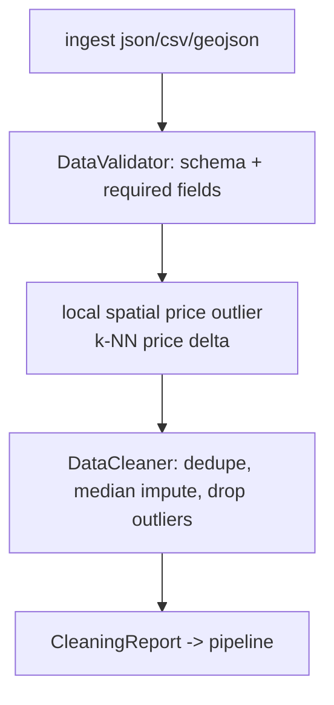

# Visual layer options — real-estate-spatial

No images exist in this repo. Problem is absence, not quality. Pick one track.

## Option A — Real artefacts, zero generation (~1.5h)
Screenshots the actual thing instead of illustrating it.

1. CLI transcripts as SVG via `asciinema` + `svg-term-cli` — real output of `res-spatial validate`, `comps`, `value`, `portfolio`.
2. Coverage badge + real numbers already in `coverage.xml`.
3. One `matplotlib` figure per algorithm, generated from `SyntheticRealEstateGenerator`:
   - submarket price heat map (real KDTree output)
   - comps radius scatter with subject property centred
   - confidence-spread histogram from `ValueOrchestrator`
4. Commit under `docs/img/`, reference from README.

Cheapest. Everything is evidence, nothing is decoration. No gflow credits.

## Option B — Diagram-first (~1h, mermaid, no pixels)
Section §6 read like a flow, not prose.

- GitHub renders it. No files, no generation, no credits.
- Covers the "too texty" complaint for the section he actually asked about.

## Option C — gflow hero images (~30-60 min + queue)
Google Flow, free on AI Pro subscription for images.

- 1 hero per top-level docs page: abstract aerial-parcel/topography compositions, dark UI palette.
- 1 video loop for README header (video draws Flow credits).
- Weak point: AI imagery of "real estate data" is generic stock slop. It decorates, it does not explain.

## Option D — C then A (recommended)
Hero/abstract from gflow for the landing surface, then real generated charts + CLI SVG for the meat.

Rule applied: never let a generated image carry a technical claim. If it encodes data, it comes from code.

---

## Section reorg (the "Diagnosis Engine" ask)

Current §6 is 3 subsections of prose. Proposed shape, each 40-80 words + one visual:

| block | content | visual |
|---|---|---|
| 6.1 Intake | multi-format loader, format sniffing | mermaid ingest fan-in |
| 6.2 Structural rules | schema/required-field/type violations -> `ValidationIssue` | table of issue codes |
| 6.3 Spatial price anomaly | k-NN price delta vs neighbourhood median | scatter PNG from real data |
| 6.4 Cleaning | dedupe, median impute, outlier drop -> `CleaningReport` | before/after count table |
| 6.5 Failure policy | zero-hard-dep fallbacks, what degrades vs raises | mermaid decision node |

Split out of §6 into its own `docs/DIAGNOSTICS.md`? Only if §6 exceeds ~50 lines. It won't. Keep it in ARCHITECTURE.md.

---

## Blocked
- Track choice (A / B / C / D).
- If C/D: gflow needs a browser session; confirm Flow is reachable from this machine.
- No app to screenshot — nothing serves HTTP in this project. Screenshots means terminal, not browser.
